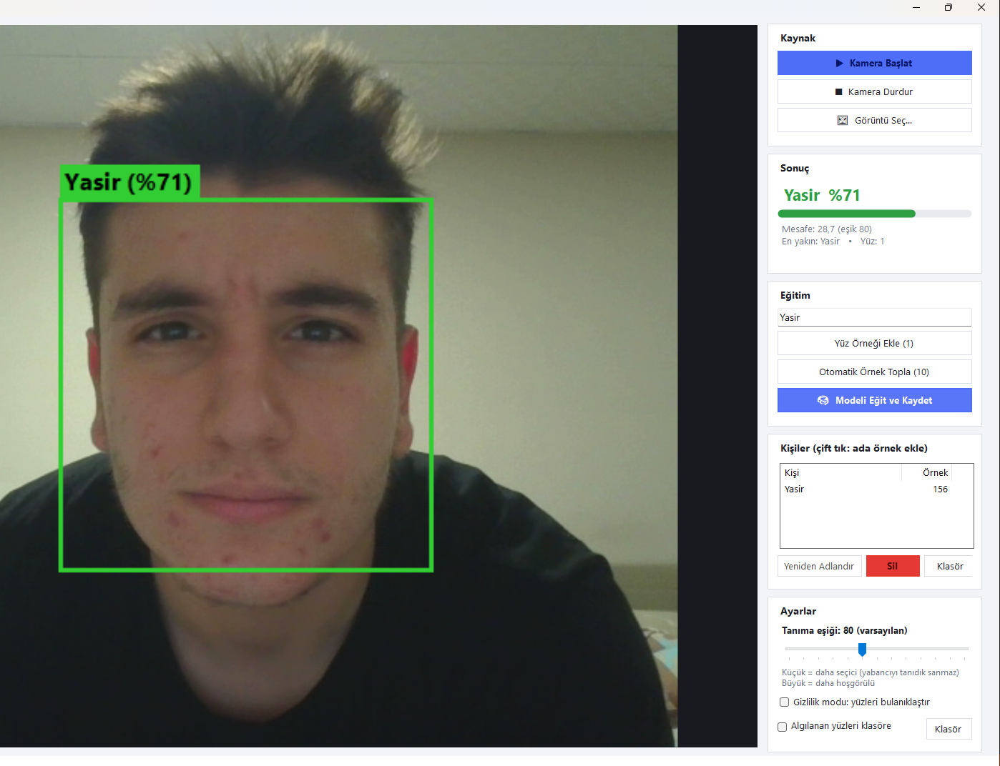

# OpenCV ile Yüz Algılama ve Tanıma

Nesne Tabanlı Programlama (YMH 219) dersi ek uygulama ödevi.
OpenCvSharp kullanarak kameradan veya resim dosyasından alınan görüntüde yüzleri **algılayan** (Haar Cascade)
ve gönüllülerden toplanmış küçük bir yerel örnek kümesiyle **tanıyan** (LBPH) bir Windows Forms uygulaması.

## Kullanılan Teknolojiler
- C# / .NET 10, Windows Forms
- NuGet: `OpenCvSharp4` ve `OpenCvSharp4.runtime.win` (4.13.0.20261107, opencv_contrib dahil)
- Yüz algılama: Haar Cascade (`Models/haarcascade_frontalface_default.xml`, OpenCV projesinden)
- Yüz tanıma: LBPH (`OpenCvSharp.Face.LBPHFaceRecognizer`)

## Özellikler
- **Kamera Başlat / Durdur** ve **Görüntü Seç** (jpg, png, bmp)
- Algılanan her yüz dikdörtgenle işaretlenir (aynı karede birden fazla yüz desteklenir)
- Tahmin edilen etiket ve güven skoru hem yüzün üstünde hem de sağ panelde gösterilir
  - Yeşil: tanındı, Turuncu: bilinmiyor (mesafe eşiğin üstünde), Mavi: model henüz eğitilmedi
- **Basit eğitim ekranı**: etiket yaz → **Yüz Örneği Ekle** veya **Otomatik Örnek Topla (10)** → **Modeli Eğit**
- Eklenen yüz örnekleri `Dataset/<etiket>/` klasörüne kaydedilir; uygulama açılışta modeli otomatik eğitir
- Kamera, model dosyası veya resim bulunamazsa kullanıcıya anlaşılır hata mesajı gösterilir
- Durum çubuğunda anlık FPS (saniyedeki kare sayısı) gösterilir

## Performans İyileştirmeleri
| Önlem | Etkisi |
|---|---|
| Kare okuma ve işleme **arka plan iş parçacığında** (`Task.Run` + `CancellationToken`) | Arayüz donmaz, butonlar her zaman tepki verir |
| Algılama **küçültülmüş görüntüde** (en fazla 320 px genişlik), kutular orijinal boyuta geri ölçeklenir | Haar Cascade yaklaşık 4 kat daha az piksel tarar |
| Algılama **her 2 karede bir**, aradaki karede son kutular kullanılır | İşlem yükü yarıya iner |
| Mat → Bitmap dönüşümü **doğrudan bellek kopyası** (`LockBits`) | Önceki .bmp kodla/çöz yönteminden çok daha hızlı |
| Kamera çözünürlüğü **640x480**'e sabitlenir | 720p/1080p veren kameralarda gereksiz yük olmaz |
| Arayüz önceki kareyi göstermeden yeni kare gönderilmez (kare atlama) | Gecikme birikmez, görüntü canlı kalır |
| Tanıma modeli `lock` ile korunur | Eğitim sırasında arka plandaki tahminle çakışma olmaz |

## Sınıf Yapısı
| Sınıf | Görevi |
|---|---|
| `CameraService` | Kamerayı açma (async), kare okuma, kapatma |
| `FaceDetector` | Haar Cascade ile yüzlerin yerini bulma |
| `FaceDataset` | Örnek yüzleri etiket klasörlerinde saklama / listeleme |
| `FaceRecognizerService` | LBPH modelini eğitme ve tahmin yapma (iş parçacığı güvenli) |
| `FrameProcessor` | Bir kareyi işler: küçültülmüş algılama → tanıma → kutuları çizme |
| `FrameResult`, `FaceResult` | İşlenmiş karenin ve tek bir yüzün sonucu |
| `RecognitionResult`, `TrainResult` | Tahmin ve eğitim sonuçlarını taşıyan kayıtlar (record) |
| `ImageUtils` | Gri tonlama, yüz kırpma, Mat ↔ Bitmap, Türkçe karakterli yollarda güvenli dosya okuma/yazma |
| `Form1` | Arayüz ve olayların bağlanması |

## Kurulum ve Çalıştırma
1. Depoyu klonlayın:
   ```
   git clone https://github.com/YasirCelikStack/YMH219-FaceRecognition.git
   ```
2. `YMH219-FaceRecognition.slnx` dosyasını Visual Studio 2026 ile açın (.NET 10 SDK gerekir).
   NuGet paketleri ilk derlemede otomatik indirilir.
3. `F5` ile çalıştırın.

## Kullanım
1. **Kamera Başlat**'a basın.
2. Etiket kutusuna adınızı yazın ve **Otomatik Örnek Topla (10)**'a basın; toplama sürerken başınızı hafifçe sağa-sola çevirin.
   (İsterseniz **Yüz Örneği Ekle (1)** ile tek tek de ekleyebilirsiniz. Kişi başı 10-20 örnek önerilir.)
3. İkinci bir gönüllü (veya kendi yüzünüzün farklı bir durumu, ör. gözlüklü) için 2. adımı başka bir etiketle tekrarlayın.
4. **Modeli Eğit**'e basın. Artık kameradaki yüzlerin üstünde tahmin edilen isim görünür.

**Güven skoru hakkında:** LBPH bir *mesafe* değeri verir; küçük mesafe = daha benzer.
Mesafe 80'in üstündeyse sonuç "Bilinmiyor" olur. Arayüzdeki yüzde, `100 - mesafe` ile hesaplanan kaba bir göstergedir.

## Ekran Görüntüleri



## Bilinen Sınırlamalar / Geliştirme Notları
- LBPH basit bir yöntemdir; ışık, açı ve uzaklık değişince doğruluk düşer. Örnekleri farklı ışık ve açılarda eklemek sonucu iyileştirir.
- Haar Cascade en iyi önden bakan yüzlerde çalışır; yandan bakan yüzleri kaçırabilir.
- Algılama 320 px genişliğe küçültülmüş görüntüde yapıldığı için büyük grup fotoğraflarındaki çok küçük yüzler kaçabilir.
- `Dataset/` klasörü kişisel veri içerdiği için `.gitignore` ile repoya eklenmemiştir.

## Etik ve Kapsam
Bu uygulama yalnızca ders kapsamında, **izin veren gönüllülerin** yerel örnekleriyle denenmiştir.
Kamuya açık alanlarda izinsiz kimlik tespiti, gizli görüntü toplama veya uzaktan izleme amacıyla kullanılmamalıdır.
Uygulama görüntüleri hiçbir yere göndermez; tüm veriler bilgisayarda yerel olarak kalır.

## Geliştiren
- Ad Soyad: Muhammet Yasir Çelik
- Öğrenci No: 250542010
